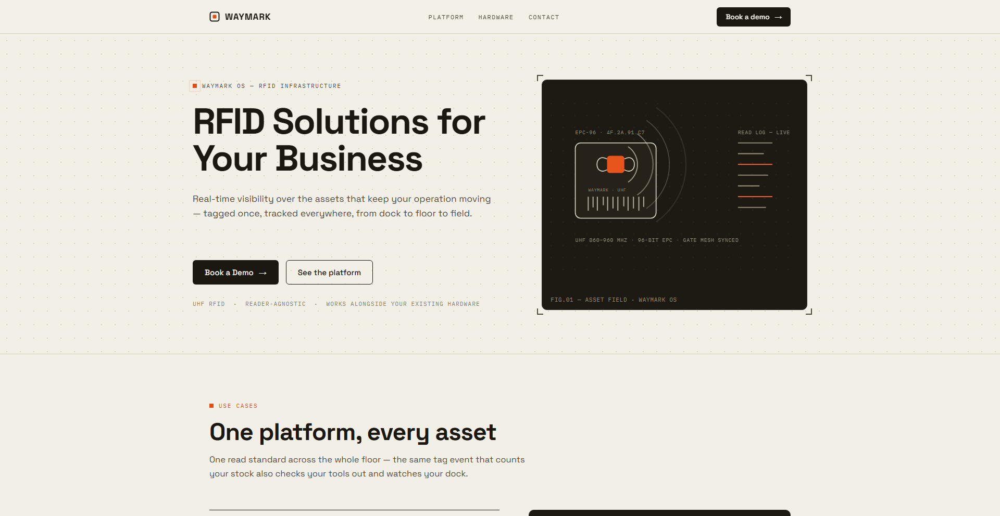
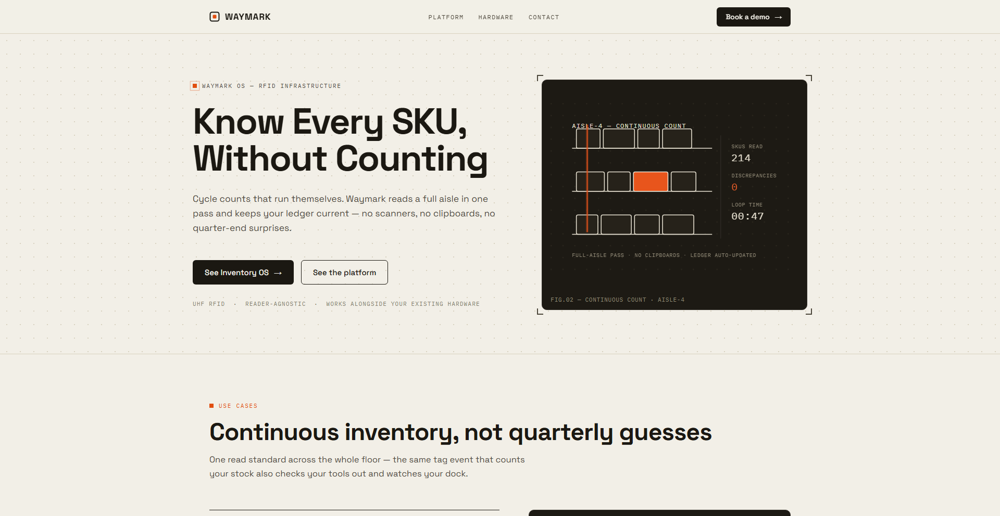
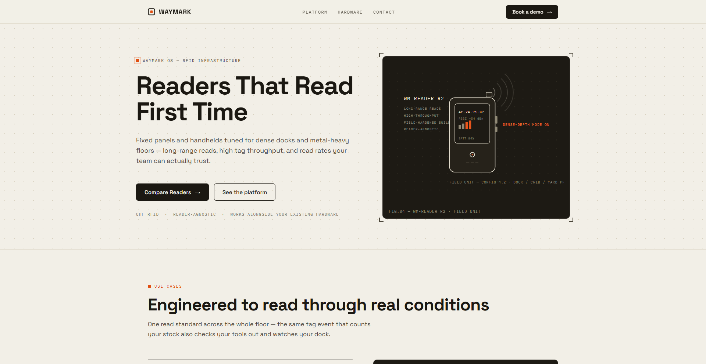
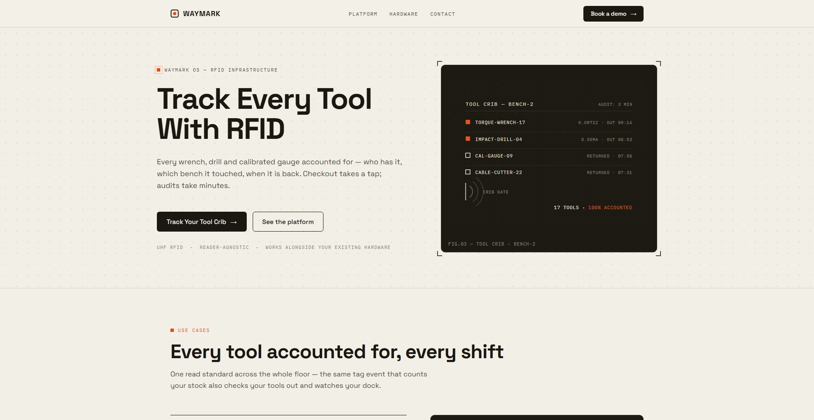
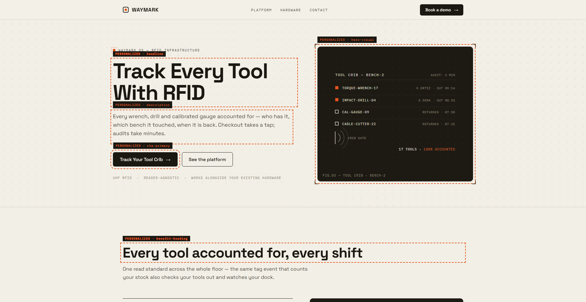

# Zephra Dynamic Landing

[](https://github.com/Imnasir-X/zephra-dynamic-landing/actions/workflows/ci.yml)
[](./LICENSE)


A deterministic, fail-open personalization layer that adapts an existing landing page to the visitor intent carried in its URL, without a backend, a framework, or AI.

Built by Nasir Khan as a technical evaluation for Zephra AI (AI/ML Intern role).


## Features

- Reads four tracked URL parameters (`keyword`, `ad`, `campaign`, `source`) and maps them to one of three pre-approved variants: Inventory, Tool Tracking or RFID Hardware.
- Two-tier classification: exact-phrase allow-list first, then single-word lexicon scoring for free-form keywords.
- Changes exactly five `data-dl` targets (headline, description, primary CTA, benefit heading, hero visual) and nothing else.
- Fail-open by design: unknown, missing or hostile input leaves the original page untouched, and the page renders identically with JavaScript disabled.
- Never renders URL text: all copy comes from a static config and is written with `textContent` or the `hidden` attribute.
- `?debug=true` logs each pipeline stage and outlines the changed targets without affecting variant selection.
- Unit tests on Node's built-in runner plus a headless-Chromium run of the in-browser DOM suite.

## Tech stack

- Vanilla JavaScript (ES2019), HTML and CSS; zero runtime dependencies
- Node.js 20+ built-in test runner (`node --test`)
- ESLint 9 (flat config)
- Playwright (Chromium) for the browser test run
- GitHub Actions CI on Node 20 and 22

## Quick start

```bash
git clone https://github.com/Imnasir-X/zephra-dynamic-landing.git
cd zephra-dynamic-landing
npm start                       # python3 -m http.server 3000, or: npx serve .
```

Open <http://localhost:3000/index.html?source=google&keyword=rfid-tool-tracking> to see the Tool Tracking variation, or <http://localhost:3000/demo.html> for the evaluation console.

To run the checks:

```bash
npm ci
npm run lint
npm test                        # unit tests, no browser needed
npx playwright install chromium # once
npm run test:browser            # in-browser DOM suite in headless Chromium
```

---

## Background

A deterministic, fail-open personalization layer for an **existing** landing page:
read URL context → classify visitor intent → apply one approved variant to exactly
five DOM elements. No backend, no AI, no framework, no duplicated pages.

> **Framing note.** `index.html` represents the client's *existing* site and is the
> untouched source of truth — it renders identically with `dynamic-landing.js`
> removed or JavaScript disabled. The production artifact authored for this
> evaluation is a single dependency-free file: [`dynamic-landing.js`](./dynamic-landing.js).
> `demo.html` + `demo-console.js` are an optional evaluation/development harness
> only (the harness is `index.html` plus exactly one `<script>` tag; all console
> UI is injected at runtime). The production solution works entirely from the
> browser address bar on `index.html`.

## 1. Problem understanding

Paid traffic arrives with intent embedded in the URL
(`?source=google&keyword=rfid-tool-tracking`). A generic headline wastes it.
The task: let one landing page adapt — within strict limits — so the message
matches the intent, while guaranteeing the original page survives any
unrecognized, missing, or hostile input unchanged.

Explicitly out of scope (per brief): rebuilding the site, multiple landing
pages, a backend, and AI/ML classification.

## 2. Architecture

```
                    ┌──────────────────────────────┐
URL query ─────────▶│ parseContext()               │  read the 4 tracked params
                    └──────────────┬───────────────┘  normalize (trim·lower·[ _]→-)
                                   ▼
                    ┌──────────────────────────────┐
                    │ detectVariant()   (pure)     │  tier 1: exact-phrase allow-list
                    │                              │  tier 2: lexicon word scoring
                    └──────────────┬───────────────┘
                     variant │         │ null
                             │         └──────────▶ original page, untouched
                             ▼
                    ┌──────────────────────────────┐
                    │ applyVariant()               │  the ONLY DOM writer
                    │ 5 approved [data-dl] targets │  textContent / hidden only
                    └──────────────────────────────┘
```

The pipeline is explicit: `URLSearchParams → parseContext() → detectVariant() →
approved VARIANTS config → applyVariant() → selected DOM elements`. URL values
may only determine a known semantic variation; they are never rendered.

## 3. Why vanilla JavaScript

Vanilla JavaScript was intentionally selected because the task is a small
DOM-personalization layer for an existing page. Introducing React, a backend,
or an application framework would add unnecessary complexity without improving
the required functionality.

Concretely: the layer is one file, zero dependencies, loaded with `defer` on
any static host. A framework would demand a build step, a component rewrite of
the client's page, and a larger attack/maintenance surface — while the brief
explicitly excludes backends and AI. The classifier is ~40 lines of pure,
unit-testable functions; that is the correct size for the problem.

## 4. Project structure

```
zephra-dynamic-landing/
├── index.html                     ← existing landing page (source of truth)
├── styles.css                     ← base page styles (authored with the page)
├── dynamic-landing.js             ← the deliverable (pure core + DOM layer)
├── demo.html                      ← index.html + exactly one <script> tag
├── demo-console.js                ← evaluation harness (loaded ONLY by demo.html)
├── tests/
│   ├── dynamic-landing.test.js    ← npm test (node --test, zero deps)
│   └── browser.test.js            ← npm run test:browser (headless Chromium)
├── docs/                          ← screenshots and narrated demo video
├── .github/workflows/ci.yml       ← lint + tests on Node 20 and 22
├── eslint.config.js
├── package.json
├── LICENSE
└── README.md
```

`demo.html` is byte-identical to `index.html` except for one added line
(`<script src="./demo-console.js" defer>`). The clean `index.html` contains no
demo-console UI, test controls, scenario buttons, or harness-specific code.

## 5. Accepted URL parameters

| Param      | Tier(s) applied            | Recognized values (normalized) |
|------------|----------------------------|--------------------------------|
| `keyword`  | phrase + lexicon (intent)  | see `CONFIG.phrases.keyword` + `CONFIG.lexicon` |
| `ad`       | phrase + lexicon (intent)  | e.g. `stop-losing-tools`, `cut-stockouts` |
| `campaign` | phrase only (channel)      | e.g. `warehouse-q1`, `toolroom-launch` |
| `source`   | phrase only (channel)      | e.g. `google`, `meta`, `construction-dive` |
| `debug`    | none — observability flag  | `debug=true` enables logging + outlines |

`source=google` alone deliberately does **not** personalize: a channel name is
context, not intent. Channel params personalize only on their own approved
partner/campaign values.

## 6. Matching and precedence rules

1. **Normalization** — trim, lowercase, fold whitespace/underscores to hyphens,
   collapse hyphen runs. Matching is **exact equality** against allow-lists;
   substring matching (`includes`) is never used, so `keyword=fake-tool-tracking-scam`
   cannot over-match.
2. **Precedence across params** — `keyword > ad > campaign > source` (declared in
   `CONFIG.paramPrecedence`). The first parameter that classifies wins; an
   unrecognized high-precedence param does not veto a recognized lower one.
3. **Two tiers within a param** — exact phrase first; if missed, `keyword`/`ad`
   values are tokenized on `-` and scored against per-category lexicons
   (inventory: `inventory/stock/warehouse/…`; tools: `tool/tools/equipment/…`;
   hardware: `reader/readers/hardware/handheld/…`). Highest score wins; ties
   resolve by declared category order (`inventory > tools > hardware`).
4. **Lexicon scope** — intent params only. Fuzzy-matching channel names has no
   upside and adds mis-classification risk.
5. **Convergence** — different acquisition parameters may resolve to the same
   variation, e.g. `keyword=rfid-tool-tracking` and `ad=stop-losing-tools` both
   → `tools`.

Worked examples:

| Input | Route | Result |
|---|---|---|
| `?source=google&keyword=rfid tool tracking` | phrase (`rfid-tool-tracking`) | tools |
| `?keyword=tracking-industrial-tools` | lexicon (`tools`) | tools |
| `?keyword=RFID_Reader` | phrase (normalized) | hardware |
| `?source=meta&ad=stop-losing-tools` | ad phrase | tools |
| `?keyword=random-value` | no match | **original** |

## 7. DOM elements modified (all five, exactly)

| Selector (`data-dl`) | Element | Original | e.g. Tools variant |
|---|---|---|---|
| `headline` | `<h1>` | RFID Solutions for Your Business | Track Every Tool With RFID |
| `description` | `<p>` | generic description | tool-crib description |
| `cta-primary` | CTA label | Book a Demo | Track Your Tool Crib |
| `benefit-heading` | `<h2>` | One platform, every asset | Every tool accounted for, every shift |
| `hero-visual` | illustration | FIG.01 default | FIG.03 (visibility toggle) |

Stable `data-*` selectors throughout — no `nth-child` brittleness. The hero swap
only toggles `hidden` on four **pre-authored** `<figure>` blocks; the layer never
constructs markup at runtime. `min-height` on headline/description prevents layout
shift. Nav, ledger, read-stream, specs strip, and footer are never touched.

## 8. Security model

- **Arbitrary URL content is never rendered.** URL context only selects
  pre-approved content: every rendered string originates from the static
  `VARIANTS` config; writes use `textContent` and the `hidden` attribute —
  never `innerHTML`. Arbitrary input is inert by construction (a test asserts
  an `onerror` payload never executes).
- Output space is closed: any input maps to at most one of three approved variants.
  The worst possible outcome of a classification mistake is a *different approved*
  variant — never unapproved content.
- The production file never mutates the URL and makes no network calls.

## 9. Fail-open behaviour

- Every run begins by **restoring all personalization targets to their pristine
  state** (snapshot captured before any personalization), then applies the
  selected variant. Re-running never leaves residue; switching
  `Tools → Inventory → Unknown → Original` always returns to exact original content.
- Missing/unknown/invalid/hostile context ⇒ variant `null` ⇒ original page.
- A missing optional DOM target is skipped and logged — it cannot crash the run.
- JavaScript disabled ⇒ the layer never runs ⇒ the original page renders
  (the brief's success criterion).

## 10. Setup instructions

No build step, no dependencies. Any static file server works:

```bash
cd zephra-dynamic-landing
python3 -m http.server 3000        # or: npx serve .
```

- Production page: <http://localhost:3000/index.html>
- Evaluation harness: <http://localhost:3000/demo.html>

(The harness also works from `file://`; serving over localhost gives the real
address-bar experience recommended for the demo.)

## 11. Sample URLs

```
/index.html                                              → original
/index.html?                                             → original
/index.html?source=google&keyword=rfid-inventory-tracking → inventory
/index.html?source=google&keyword=rfid-tool-tracking      → tools
/index.html?source=google&keyword=rfid-reader             → hardware
/index.html?source=meta&ad=stop-losing-tools              → tools (convergence)
/index.html?keyword=random-value                          → original
/index.html?keyword=<script>alert(1)</script>             → original (inert)
/index.html?debug=true                                    → original + pipeline log
```

In production the brief's `/product` path maps to `index.html`; the layer reads
**only the query string**, so the path is irrelevant to classification.

## 12. Running tests

```bash
npm test          # Node 20+ built-in runner, zero dependencies
```

Covers: the required scenario table (inventory/tool/hardware keywords, Meta/ad
tool scenario), case-insensitivity, normalization, all four params, convergence,
two-tier matching, precedence, fall-through, unknown keyword, empty context,
invalid/untracked parameters, hostile input, and config-integrity guards (every
phrase maps to a declared variant; lexicon entries are single words; `debug` is
untracked). DOM-level behaviour (switching variants, restoration to pristine DOM,
only approved targets changing, hostile payload inert) is covered by the
in-browser suite in `demo.html`, which `npm run test:browser` runs in headless
Chromium (it also checks the URL-driven variants on `index.html` and that the
page does not scroll horizontally on a 390 px phone viewport). Syntax checks:
`npm run check`. Lint: `npm run lint`.

## 13. Debug mode

`?debug=true` logs each pipeline stage (raw params → normalized context → matched
rule → changed targets) via `console.info` and outlines changed targets. It is
purely additive observability: an assertion-backed test guarantees `debug` never
changes which variant is selected. Enable by URL only — no build flag.

## 14. Adding another variation

1. Add the copy object to `VARIANTS` (all fields required — an integrity test enforces it).
2. Add a lexicon category and/or phrase mappings in `CONFIG` for `keyword`/`ad` (and channel params if relevant).
3. Author a new `<figure data-visual="...">` in `index.html` (pre-approved content).
4. Extend `categoryPrecedence` if a tie-break order must include it.
5. Add tests; run `npm test`. No changes to pipeline code are needed — that's the point of the config-driven design.

## 15. Engineering trade-offs

- **Deterministic classification, not ML.** The brief excludes AI, and the input
  space (4 short params) is fully coverable by allow-lists. Predictability and
  auditability beat coverage here.
- **Two-tier matching** recovers reasonable recall for free-form keywords
  (`tracking-industrial-tools`) without giving up the allow-list security property.
- **Channel params stay phrase-only** (documented asymmetry, pinned by a test:
  `?source=reader-gazette → null`): a channel identifier carries no semantic
  signal worth fuzzy-matching.
- **Fail-open + restore-first.** Every run begins pristine; every uncertain outcome
  returns `null`. Partial personalization is structurally impossible.
- **Pure core / DOM shell split.** Chosen so tests need no browser, no jsdom, no
  framework — the suite runs in well under a second with `node --test`.
- **Harness as one script tag.** `demo.html` differs from `index.html` by one line,
  proving the production page carries no evaluation code.

## 16. Known limitations

- The lexicon can mis-classify contrived inputs (e.g. negations like
  `non-tool-policy`). Accepted: the worst case is a different *approved* variant,
  never unapproved content, and no decision of consequence depends on accuracy.
- Duplicate params (`?keyword=a&keyword=b`): the first value wins (`URLSearchParams.get`).
- Deferred execution can show a brief flash of original content on very slow
  connections. The direction is safe: original → personalized, never personalized
  → original after load.
- Fixed to the brief's three variants on one page; no SPA router integration,
  no persistence, no analytics.

## 17. Possible future improvements

- Ship a strict CSP (`script-src 'self'`) — the layer already complies.
- Optional, opt-in variant-attribution hook (an event, not a tracker).

## Demo video & screenshots

**[Watch the narrated demo video](./docs/demo-video-narrated.mp4)** (5 min 57 s, 1080p, English narration)

The video walks through: the original page → each required variation (Inventory, Tool Tracking, RFID Hardware, the Meta ad example) → fail-open with unknown/removed context → debug mode → a code walkthrough of `VARIANTS`, `parseContext()`, `detectVariant()` and the restore-first `runPipeline()` → the full `npm test` suite passing. Every frame shows the exact URL that produced it, and each scenario was programmatically assert-verified during capture (the rendered headline was read back from the live DOM and checked against the expected variant copy).

Sample frames (full set in [`docs/`](./docs)):

| | |
|---|---|
|  |  |
| **Original page — no context** | **Inventory variation** |
|  |  |
| **Tool Tracking variation** | **RFID Hardware variation** |
|  |  |
| **Meta ad → same Tools variation** | **Debug mode — outlines + pipeline log** |

---

## Demo video outline

Record with the browser address bar visible throughout, on `index.html`
(localhost), to show personalization comes from URL context. The published
video follows this exact flow:

1. `00:00` — original page, no parameters.
2. `00:26` — `?source=google&keyword=rfid-inventory-tracking` → Inventory variation.
3. `01:06` — `?source=google&keyword=rfid-tool-tracking` → Tool Tracking variation.
4. `01:44` — `?source=google&keyword=rfid-reader` → RFID Hardware variation.
5. `02:04` — `?source=meta&ad=stop-losing-tools` → Tool Tracking (Meta ad example).
6. `02:26` — `?keyword=random-value` → original content preserved.
7. `02:46` — remove parameters → pristine original restored.
8. `03:01` — `?debug=true` → pipeline log + outlined targets.
9. `03:25` — code walkthrough: `VARIANTS`, `parseContext()`, `detectVariant()`,
    `applyVariant()`, restoration/fail-open logic.
10. `04:51` — `npm test` passing.

## License

Released under the [MIT License](./LICENSE). Copyright (c) 2026 Nasir Khan.
